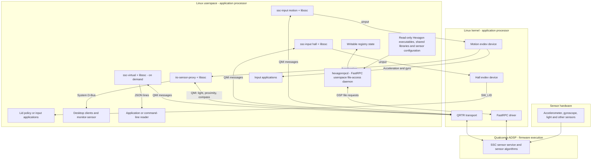

# Lenovo Elden sensors

Private sensor support for Lenovo Y700 Gen4. No services are installed by this package.
The distribution supplies service definitions and initialization scripts separately.
Hardware validation currently covers Lenovo Elden only.

## Debian Trixie arm64

Install build dependencies:

```sh
sudo apt install build-essential git cmake meson ninja-build pkg-config ca-certificates \
  protobuf-c-compiler protobuf-compiler libprotobuf-c-dev libglib2.0-dev \
  libqmi-glib-dev libqrtr-glib-dev libgudev-1.0-dev libpolkit-gobject-1-dev \
  python3-dev python3-protobuf python3-gi qrtr-tools
bash scripts/build-deb.sh "$PWD/work"
```

The script fetches immutable revisions from `sources.lock` and applies `patches/`.
Set `SOURCE_MIRROR` to a directory containing Git repositories named `hexagonrpc`, `libssc` and `iio-sensor-proxy`, each containing its pinned commit, for offline source fetching. Relative paths are resolved from the directory where the script is invoked.
It builds all components privately under `/usr/share/lenovo-elden-sensors`.
The output includes a deb and corresponding upstream source archive.
System GLib, QMI, protobuf-c and libc remain dynamic dependencies.

The package does not start daemons during installation.
Consumers must set `LD_LIBRARY_PATH=/usr/share/lenovo-elden-sensors/lib` for private executables.
The installed `lenovo-elden-sensors-virtual` wrapper sets this variable itself.

## CMake

CMake builds only the bridges, virtual sensor tool and decoder tests.
It never downloads dependencies, installs systemd units or executes target binaries during cross-compilation.
Build the patched libssc with Meson and expose its pkg-config metadata to CMake. A package-private build can use its `meson-uninstalled` directory through `PKG_CONFIG_PATH`; installing it into a shared target sysroot is not required. When cross-compiling, configure CMake's library search roots to include that private build directory as well as the target sysroot. Build hexagonrpc separately with its upstream Meson build.
Build the patched iio-sensor-proxy with Meson only if D-Bus sensor integration is needed.
Use the revisions and patches in this repository.

```sh
cmake -S . -B build -DCMAKE_INSTALL_PREFIX=/usr/share/lenovo-elden-sensors \
  -DCMAKE_INSTALL_LIBDIR=lib -DBUILD_TESTING=OFF -DINSTALL_RUNTIME_DATA=ON \
  -DCMAKE_TOOLCHAIN_FILE=/path/to/toolchain.cmake
cmake --build build
DESTDIR=/path/to/target cmake --install build
```

Provide host `protoc-c` and target `libssc`, `gio-unix-2.0` and `libprotobuf-c` pkg-config files.
Buildroot supplies the common host tools and target libraries through its dependency packages. The private hexagonrpc/libssc sources can be built within the sensor package.
Extracted files and their checksum manifests are grouped under `vendor/`.
`INSTALL_RUNTIME_DATA=ON` installs the vendor runtime resources and fallback sensor registry snapshot. The Hexagon DSP executables and shared libraries default to `runtime/dsp` below the installation prefix; `DSP_INSTALL_DIR` accepts an absolute path or a path relative to the prefix. Sensor configuration and the fallback registry remain below the prefix.

For Batocera/Buildroot, add `-DDSP_INSTALL_DIR=/lib/firmware/lenovo-elden-sensors/dsp`. These vendor-supplied ELF binaries execute on the Hexagon DSP rather than the Linux application processor and must retain their original bytes. Buildroot's target RPATH sanitizer excludes `/lib/firmware`, protecting the binaries' embedded dynamic-library search paths from modification. Other binary post-processing must be checked separately.

CMake installs the DSP executables and shared libraries into the selected directory and supports `DESTDIR` staging. Distribution initialization scripts must map that directory into the filesystem root supplied to `hexagonrpcd -R` as `dsp/`. The Debian package uses the default layout and packages vendor runtime resources without RPATH sanitization.
CMake generates and installs `lenovo-elden-sensors-virtual`, which sets the private library search path and invokes `ssc-virtual`. Its executable and library paths follow `CMAKE_INSTALL_PREFIX`, `CMAKE_INSTALL_BINDIR` and `CMAKE_INSTALL_LIBDIR`. `WRAPPER_INSTALL_DIR` selects the wrapper destination and defaults to `CMAKE_INSTALL_BINDIR`; Debian and Batocera use `/usr/bin`. Set `INSTALL_CLI_WRAPPER=OFF` to omit it. Configure the final installation prefix before building; the wrapper embeds that prefix, not `DESTDIR`.

For native tests, enable `BUILD_TESTING` and run `ctest --test-dir build --output-on-failure`.

## Service integration

This section assumes the Linux executables, private libraries and vendor runtime resources are already installed.
The examples use `/usr/share/lenovo-elden-sensors`; adapt paths for other distributions.
Services and initialization policy belong to the distribution, not this package.

### Prepare the runtime

Provide `/dev/fastrpc-adsp-secure`, `/dev/uinput`, QRTR support and the running ADSP sensor service.
The proxy also needs a system D-Bus and its installed D-Bus/polkit policies.
Use root for the commands below. Set the library path per service, not globally:

```sh
prefix=/usr/share/lenovo-elden-sensors
```

Before starting `hexagonrpcd`, prepare its `-R` directory with these entries:

| Entry below the root directory | Resource |
| --- | --- |
| `dsp/adsp/` | Executables and shared libraries from the `adsp/` subdirectory of `DSP_INSTALL_DIR` |
| `sensors/config/` | Read-only sensor configuration from `runtime/sensors/config/` |
| `sensors/sns_reg.conf` | Read-only registry configuration from `runtime/sensors/sns_reg.conf` |
| `sensors/state/` | Writable registry copy, including `registry/`, `sns_reg_version` and other metadata |
| `socinfo/` | `/sys/devices/soc0` |

Only registry state should be writable through the DSP mapping; vendor runtime resources must remain read-only.
Prefer calibration from the current device. Use the bundled fallback only when device calibration is unavailable.
Keep state across boots, record its origin separately and warn on every fallback boot.
Never expose Android persist as writable DSP state.

Armbian's `lenovo-elden-sensors-init` performs this preparation under `/var/lib/hexagonrpc`.
Other distributions must provide equivalent initialization before starting the daemons.

### Startup order

Supervise the long-running processes, either as separate services or as a process group managed by the distribution. These commands run in the foreground; the commands in each code block are separate process invocations.

1. Complete runtime initialization and wait for the FastRPC device.
2. Start the FastRPC userspace file-access daemon:

   ```sh
   env LD_LIBRARY_PATH="$prefix/lib" "$prefix/bin/hexagonrpcd" \
       -f /dev/fastrpc-adsp-secure -d adsp -s -R /var/lib/hexagonrpc
   ```

3. Start the two independent input bridges:

   ```sh
   env LD_LIBRARY_PATH="$prefix/lib" "$prefix/bin/ssc-input" motion
   env LD_LIBRARY_PATH="$prefix/lib" "$prefix/bin/ssc-input" hall
   ```

4. For D-Bus sensor integration, start the private proxy with the distribution's D-Bus service integration:

   ```sh
   env LD_LIBRARY_PATH="$prefix/lib" "$prefix/libexec/iio-sensor-proxy"
   ```

Only one proxy should own `net.hadess.SensorProxy`. Do not run the distribution binary alongside the private one.
The input bridges and proxy subscribe through libssc; they do not read samples from `hexagonrpcd`.
Starting `hexagonrpcd` first provides DSP file access, but does not itself prove SSC discovery has completed.
Use supervised retries for startup failures. Stop sensor clients before stopping `hexagonrpcd`.

Install udev configuration before starting consumers:

- For iio-sensor-proxy, select `ssc-light ssc-proximity ssc-compass` for the secure ADSP FastRPC device.
- For iio-sensor-proxy, select `input-accel` for `Lenovo Y700 Gen4 Motion`, with the board's accelerometer mounting matrix.
- Expose the Hall input separately. Decide explicitly whether `SW_LID` should trigger suspend or display actions.

On Armbian, the services are `lenovo-elden-sensors-rpc.service`,
`lenovo-elden-sensors-motion.service` and `lenovo-elden-sensors-hall.service`.
`iio-sensor-proxy.service` keeps its distribution name for D-Bus activation.
Its `lenovo-elden-sensors.conf` drop-in selects the private executable and libraries.
Armbian inhibits logind lid actions; other systems must choose their own lid policy.

### Data flow



## Sensor interfaces

`ssc-input motion` exposes acceleration as ABS_X/Y/Z at 256 units/g.
Gyroscope events use ABS_RX/RY/RZ at 1024 units/(rad/s).
These event scales describe the current bridge interface, not a guarantee that
generic evdev motion consumers interpret its resolution metadata correctly.
Validate units and axis mappings before using it with an emulator.
Raw axes remain unchanged; Armbian supplies the accelerometer mount matrix through udev for iio-sensor-proxy.
`ssc-input hall` exposes SW_LID. Armbian controls the lid policy separately.

`ssc-virtual --sensor all --timeout 30` emits newline-delimited JSON.
Gravity reports include gravity XYZ and linear acceleration XYZ, in m/s².
Rotation vectors use quaternion XYZW. Accuracy values remain available to consumers.
Significant motion is one-shot and requires a new subscription after firing.
Step counts are subscription results, not a persistent daily total.

Protocol reference: Qualcomm sensinghub, commit `35cb7c99fd50fc0eb871988a10803266cb8e2889`, `apis/proto/`.
The Lenovo Elden step-detection interface uses event ID 1029 with an empty payload.

## Release

The workflow builds in Debian Trixie on an ARM64 runner.
The source archive contains patched upstream trees and the patches used to produce them.
Manual runs upload artifacts. A pushed `v*` tag also publishes release assets.
The tag must match `v` followed by the version in `packaging/control`.
Review proprietary runtime redistribution rights before publishing a tag.
Runtime data licensing is separate from the GPL-3.0-or-later C sources.
See `RUNTIME.md` for provenance. Armbian downloads the deb from a specified release version.
